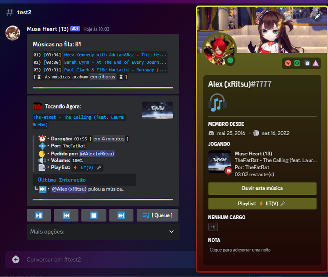
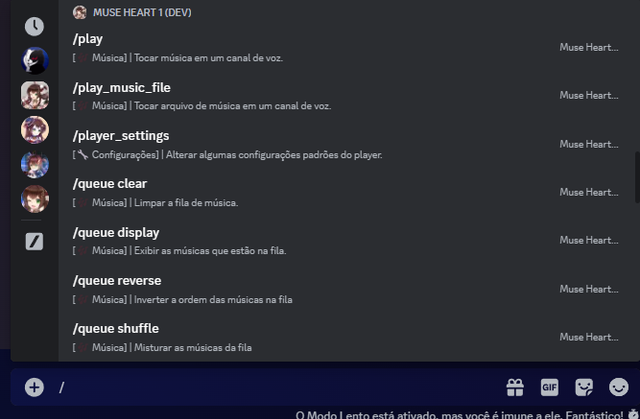
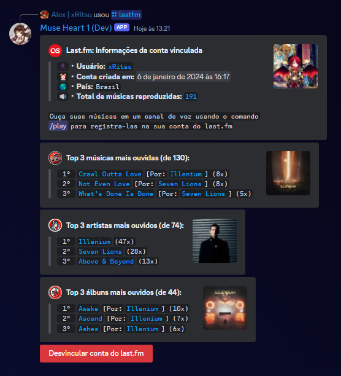
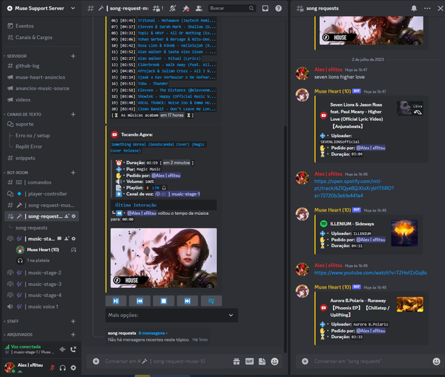
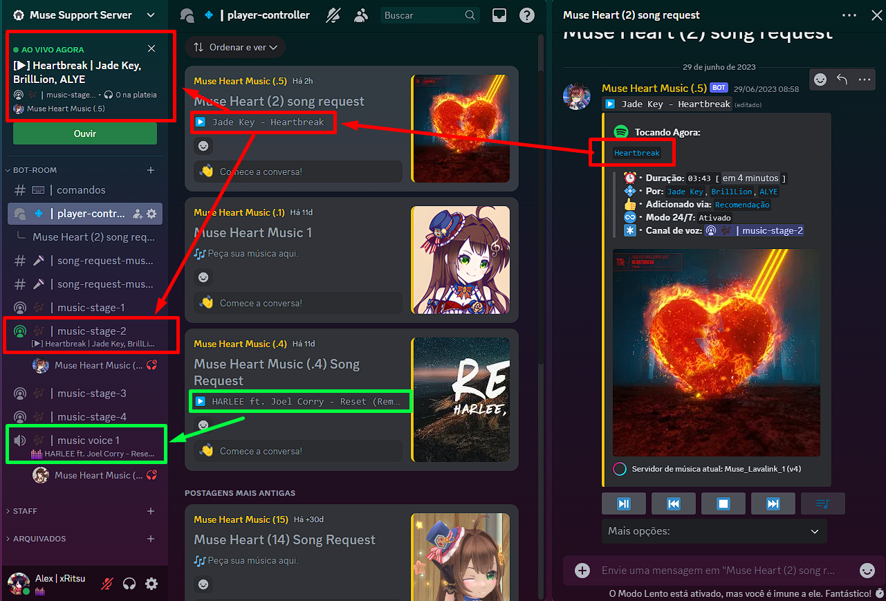

<p align="center">
  
</p>

# EmpireMuse
## bot de música programado em python com player interativo, comandos de barra + slash, integração com o [last.fm](https://www.last.fm/) e muito mais.

> **EmpireMuse** é uma obra derivada do [MuseHeart-MusicBot](https://github.com/zRitsu/MuseHeart-MusicBot), criado por **zRitsu** e distribuído sob a licença **GPL-2.0** (veja [LICENSE](LICENSE) e [CREDITS.md](CREDITS.md)).

[](https://discord.gg/KgtyNg9U6H)  
Entre no servidor oficial [Discord EmpireHUB](https://discord.gg/KgtyNg9U6H) para suporte, dúvidas e acompanhar todas as novidades.

### Algumas Previews:

- Player controller: modo normal/mini-player (skin: default) e suporte a [RPC (Rich Presence)](https://github.com/DiscordEmpireHub/EmpireMuse-RPC-app)

[](assets/readme_preview_player_default.png)

<details>
<summary>
Mais previews:
</summary>
<br>

- Comandos de barra / Slash commands

[](assets/readme_preview_slashcommands.png)

- Integração com o [last.fm](https://www.last.fm/) para scrobbles (outras funcionalidades em breve).

[](assets/readme_preview_lastfm.png)

- Player controller: modo fixo/estendido com canal e conversa de song requests (skin: default), configurável com o comando: /setup

[](assets/readme_preview_player_setup.png)

- Player controller: modo fixo/estendido com canal de song-request em forum com suporte a status automático no canal de voz e palco

[](assets/readme_preview_controller_forum.png)

* Há diversas outras skins, veja todas usando o comando /change_skin (você também pode criar outras, use os modelos padrões que estão na pasta [skins](utils/music/skins/) como referência, crie uma cópia com outro nome e modifique a seu gosto).

</details>

> As imagens de preview foram re-hospedadas em [`assets/`](assets/) e têm origem no projeto upstream; a substituição por arte própria está planejada (veja [CREDITS.md](CREDITS.md)).

## Hospede o seu próprio bot com essa source:

Guias passo a passo (em português, com imagens) estão em [`docs/guides/`](docs/guides/README.md).

---

<details>
<summary>
Repl.it
</summary>

Veja o guia com imagens: [docs/guides/replit-token.md](docs/guides/replit-token.md) (outros guias: [hospedagem](docs/guides/replit-hosting.md), [opcionais](docs/guides/replit-hosting-opcionais.md) e [atualização](docs/guides/replit-atualizar.md)).
</details>

---

**Render.com** e **Gitpod** (deploy em 1 clique): Deploy em revisão — será reativado na fase de deploy (I-7).

<!-- Deploy em revisão — será reativado na fase de deploy (I-7). Conteúdo original preservado abaixo:
<details>
<summary>
Render.com
</summary>
<br>

> Nota: os arquivos de deploy (Render, Discloud, SquareCloud, Replit e Gitpod) ainda não foram revisados para o EmpireMuse; o deploy foi adiado.

[](https://render.com/deploy?repo=https://github.com/DiscordEmpireHub/EmpireMuse/tree/main)

* **[ 1 ]** - No campo **TOKEN_BOT_1** coloque o token do bot **( [tutorial de como obter](https://www.youtube.com/watch?v=lfdmZQySTXE) )**. `Nota: Caso queira, no campo TOKEN você pode incluir token de mais bots para ter bots extras pra ativar o suporte a multi-voice incluindo mais tokens no value (separando com espaços).`


* **[ 2 ]** - No campo **DEFAULT_PREFIX** coloque um prefixo para o bot.


* **[ 3 ]** - Nos campos **SPOTIFY_CLIENT_ID** e **SPOTIFY_CLIENT_SECRET** coloque as suas keys do spotify **( [tutorial de como obter](https://www.youtube.com/watch?v=ceKQjWiCyWE) | [guia escrito](docs/guides/spotify-keys.md) )**.


* **[ 4 ]** - No campo **MONGO** coloque o link da sua database do MongoDB **( [tutorial de como obter](https://www.youtube.com/watch?v=x1Gq5beRx9k) | [guia escrito](docs/guides/mongodb.md) )**.


* **[ 5 ]** - Clique em Apply e aguarde o processo de build até o bot iniciar (isso pode demorar bastante, no mínimo uns 13 minutos ou mais para o deploy ser finalizado + bot iniciar + servidor lavalink iniciar).
</details>

---

<details>
<summary>
Gitpod
</summary>
<br>

[](https://gitpod.io/#https://github.com/DiscordEmpireHub/EmpireMuse)

* **[ 1 ]** - Abra o arquivo .env e coloque o token do bot no campo apropriado (caso não tenha, veja como obter com este tutorial [tutorial](https://www.youtube.com/watch?v=lfdmZQySTXE) de como obter). Também altamente recomendo usar mongodb, procure onde tem MONGO= no arquivo .env e nele coloque o link da sua db do mongodb (caso não tenha, veja como obter por este [tutorial](https://www.youtube.com/watch?v=x1Gq5beRx9k)).


* **[ 2 ]** - Clique com botão direito em cima do arquivo main.py e depois clique em: Run Python File in Terminal.


* **Nota 1:** Requer verificação da conta por número de celular/mobile.
* **Nota 2:** Não esqueça de ir na lista de [workspaces](https://gitpod.io/workspaces) e clicar nos 3 pontinhos do projeto e depois clicar em **pin**. `(isso evitará o worskpace ser deletado após 14 dias inativo)`
* **Nota 3:** Não use o gitpod para hospedar / manter o bot online, pois a mesma tem bastante limitações no plano gratuito (mais informações [nesse link](https://www.gitpod.io/pricing)).
</details>
-->

---

<details>
<summary>
Hospedando no seu próprio PC/VPS (windows/linux)
</summary>
<br>

### Requisitos:

* Python 3.13 (veja [docs/development.md](docs/development.md))<br/>
[Download pela Microsoft Store](https://apps.microsoft.com/store/detail/9PJPW5LDXLZ5?hl=pt-br&gl=BR) (Recomendável para usuários do windows 10/11).<br/>
[Download direto do site oficial](https://www.python.org/downloads/) (Marque esta opção ao instalar: **Add python to the PATH**)
* [Git](https://git-scm.com/downloads) (Não escolha a versão portable)</br>

* [JDK 17](https://www.azul.com/downloads) ou superior (Windows e Linux não é necessário instalar, ele é baixado automaticamente)</br>

`Nota: esta source requer no mínimo 512mb de RAM E 1Ghz de CPU para rodar normalmente (caso rode o Lavalink na mesma instância do bot considerando que o bot seja privado).`

### Iniciar bot (guia rápido):

* Baixe esta source como [zip](https://github.com/DiscordEmpireHub/EmpireMuse/archive/refs/heads/main.zip) e extraia em seguida (Ou use o comando abaixo no terminal/cmd e abra a pasta em seguida):
```shell
git clone https://github.com/DiscordEmpireHub/EmpireMuse.git
```
* dê clique-duplo no arquivo source_setup.sh (ou apenas setup caso o seu windows não esteja exibindo extensões de arquivo) e aguarde.</br>
`Caso esteja usando linux use o comando no terminal:` 
```shell
bash source_setup.sh
```
* Vai aparecer um arquivo com nome **.env**, edite ele e coloque o token do bot no campo apropriado (você também pode editar outras coisas deste mesmo arquivo caso queira fazer ajustes específicos no bot).</br>
`Nota: Caso não tenha criado uma conta de bot,` [veja este tutorial](https://www.youtube.com/watch?v=lfdmZQySTXE) `para criar seu bot e obter o token necessário.`</br>`Também altamente recomendo usar mongodb, procure onde tem MONGO= no arquivo .env e nele coloque o link da sua db do mongodb (caso não tenha, veja como obter por este` [tutorial](https://www.youtube.com/watch?v=x1Gq5beRx9k)`). ` 
* Agora basta apenas abrir o arquivo source_start_win.bat para iniciar o bot se o seu sistema for windows, caso seja linux dê clique duplo no start.sh (ou se preferir execute o bot usando o comando abaixo):
```shell
bash source_start.sh
```

### Notas:

* Para atualizar seu bot dê um clique duplo no update.sh (windows), p/ Linux use o comando no shell/terminal:
```shell
bash source_update.sh
```
`Ao atualizar, há chance de qualquer alteração manual feita ser perdida (caso não seja um fork desta source)...`<br/>

`Obs: Caso esteja rodando a source diretamente de uma máquina com windows (e que tenha git instalado) apenas dê um duplo-click no arquivo source_update.sh`
</details>

---

Nota: há mais guias em [`docs/guides/`](docs/guides/README.md).

### Observações importantes:

* Você pode usar essa source para hospedar/rodar seu próprio bot de música para uso privado ou em servidores públicos no qual você gerencia (que você tenha permissão de adicionar seu próprio bot no servidor). Entretanto não recomendo distribuir o bot usando essa source publicamente por não estar otimizado o suficiente pra lidar com alta demanda de servidores, mas se mesmo assim decidir fazer isso o bot terá que estar sob a [licença](/LICENSE) da source original (GPL-2.0) e dependendo de onde o bot estiver sendo divulgado (ex: botlists) há possibilidade de seu bot ser apontado pelo uso dessa source.


* Recomendo usar a source atual sem alterações no code. Caso queira fazer modificações (e principalmente adicionar novas funcionalidades) é altamente recomendável que tenha conhecimento em python, disnake, lavalink e etc. E caso queira manter sua source modificada com updates em dias usando a source base também recomendo ter conhecimento em git (pelo menos o necessário pra fazer um merge sem erros).


* Caso queira postar algum vídeo/tutorial usando essa source, você está totalmente livre para usá-la pra essa finalidade desde que esteja de acordo com os termos citados nos parágrafos acima.

---

### Caso tenha algum problema, poste uma [issue](https://github.com/DiscordEmpireHub/EmpireMuse/issues) detalhando o problema.

Para contribuir, veja [CONTRIBUTING.md](CONTRIBUTING.md); para reportar vulnerabilidades, veja [SECURITY.md](SECURITY.md).


## Créditos e agradecimentos:

O EmpireMuse é uma obra derivada do [MuseHeart-MusicBot](https://github.com/zRitsu/MuseHeart-MusicBot) de **zRitsu**, licenciado sob **GPL-2.0** ([LICENSE](LICENSE)). Veja a lista completa de créditos e recursos espelhados em [CREDITS.md](CREDITS.md).

* [DisnakeDev](https://github.com/DisnakeDev) (disnake) e ao Rapptz pelo [discord.py](https://github.com/Rapptz/discord.py) original
* [Pythonista Guild](https://github.com/PythonistaGuild) (wavelink)
* [Lavalink-Devs](https://github.com/lavalink-devs) (lavalink e lavaplayer)
* [DarrenOfficial](https://lavalink-list.darrennathanael.com/) Lavalink serverlist (Usuários que publicaram seus servidores lavalink estão listados no comando about junto com website/link).
* E a todos os membros que me me ajudaram bastante com reports de erros (sendo nas [issues](https://github.com/zRitsu/MuseHeart-MusicBot/issues) e no servidor do discord)
* Demais atribuições podem ser conferidas no [dependency graph](https://github.com/zRitsu/MuseHeart-MusicBot/network/dependencies)
