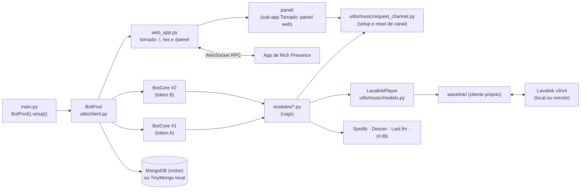

# Arquitetura do EmpireMuse

> EmpireMuse é obra derivada do [MuseHeart-MusicBot](https://github.com/zRitsu/MuseHeart-MusicBot),
> de **zRitsu** (licença GPL-2.0). Este documento descreve o código **como ele está hoje**; as referências
> `arquivo:linha` foram conferidas no código atual e podem deslocar-se com novos commits.

## 1. Visão geral

Um único processo Python (3.13) hospeda **vários bots do Discord** (um por token) e um **servidor web**
(tornado). Todo o áudio é processado por servidores **Lavalink** (v3/v4) ou NodeLink; o bot só controla os
players, a fila, a interface (embeds, botões, selects) e a persistência.

## 2. Processo e inicialização

1. `python main.py` instancia `BotPool()` e chama `pool.setup()` (`main.py:8-10`). `app.py` apenas faz
   `from main import *` (`app.py:1`) — existe para hospedagens que exigem esse nome de entrada.
2. `BotPool.__init__` (`utils/client.py:74`) carrega a configuração (`load_cfg` → `config_loader.load_config`),
   cria caches TTL, clientes Deezer/yt-dlp e restaura caches em pickle de `./local_database/` (`utils/client.py:146-167`).
3. `BotPool.setup` (`utils/client.py:567`) executa, em ordem:
   - carrega as skins (`load_skins`, `utils/client.py:486`);
   - monta a lista de nodes Lavalink: lista remota (`AUTO_DOWNLOAD_LAVALINK_SERVERLIST`), variáveis
     `LAVALINK_NODE_*` (JSON) e `lavalink.ini` (`utils/client.py:582-628`);
   - decide se inicia o Lavalink local: `RUN_LOCAL_LAVALINK` ou nenhum node configurado (`utils/client.py:630`);
   - define as intents a partir das chaves `*_INTENT` (`utils/client.py:635-637`);
   - escolhe o banco: `MONGO` preenchido → `MongoDatabase`; caso contrário `LocalDatabase` (`utils/client.py:639-650`)
     — o `LocalDatabase` é sempre instanciado;
   - cria `SpotifyClient` (se houver credenciais) e `LastFM` (`utils/client.py:680-693`);
   - varre **todas** as variáveis de ambiente/config atrás de strings com formato de token do Discord
     (`token_regex`, `utils/others.py:23`), de modo que qualquer chave pode conter um token (`utils/client.py:695-716`);
   - cria um `BotCore` por token via `load_bot` (`utils/client.py:718-902`) e, opcionalmente, bots exclusivos de
     servidor a partir de `guild_bots.json` (`utils/client.py:916-927`);
   - sobe o servidor web com `web_app.start` (se `RUN_RPC_SERVER`) ou roda `run_bots` no loop (`utils/client.py:961-988`).
4. Cada `BotCore` (`utils/client.py:991`, herda `commands.AutoShardedBot`) executa `initial_setup` depois do
   `on_ready`: carrega os módulos, sincroniza cooldowns e comandos de aplicação, registra `PanelView`
   (`utils/client.py:863-891`).
5. Ponto de extensão opcional: se existir o pacote `dev.pool_dev`, `PoolDev(self).run()` é executado
   (`utils/client.py:557-565`). Ele não existe no repositório.

### Estado compartilhado do pool

`BotPool` guarda o que é comum a todos os bots: `bots` e `guild_bots` (`utils/client.py:52-53`), a configuração,
os bancos (`database` escolhe Mongo ou local, `utils/client.py:203-209`), caches (`playlist_cache`,
`partial_track_cache`, `lyric_data_cache`), as skins e os clientes de integração. `BotCore` expõe esses
objetos por *properties* (`utils/client.py:1030-1060`).

## 3. Carregamento de módulos (cogs)

`BotCore.load_modules` (`utils/client.py:1400`) percorre recursivamente `modules/` e `modules_dev/` com `os.walk`,
e para cada `*.py` faz `unload_extension` + `load_extension` (recarrega se já estava carregado). Pontos
relevantes:

- `modules_dev/` **não existe** no repositório; a pasta é lida se for criada (útil para módulos locais sem
  versionar). Como `os.walk` em pasta inexistente não gera itens, nenhum erro ocorre.
- Antes do bot ficar pronto, falha ao carregar um módulo **interrompe** a inicialização (`raise e`,
  `utils/client.py:1439` e `utils/client.py:1445`); depois, apenas registra a falha.
- Se `ENABLE_DISCORD_URLS_PLAYBACK` for falso, o comando `play_music_file` é removido (`utils/client.py:1449`).
- Descrições de slash commands acima de 100 caracteres derrubam o carregamento (`utils/client.py:1452-1455`).

## 4. Roteamento entre bots do pool

Com vários bots no mesmo servidor, **apenas um** deve responder a cada comando. A decisão fica em
`check_pool_bots` (`utils/music/checks.py:104`):

- Comando de barra: o check global (`utils/client.py:773-844`) lê as `extras` do comando (`only_voiced`,
  `check_player`, `return_first`, `allow_private`) e chama `check_pool_bots`.
- Comando com prefixo: `PoolCommand` (`utils/others.py:138`, decorador `pool_command`, `utils/others.py:250`) guarda as
  mesmas opções; `BotCore.on_message` chama `check_pool_bots` antes de `invoke` (`utils/client.py:1286-1301`).
- Algoritmo: com menos de 2 bots no servidor, o próprio bot atende (`utils/music/checks.py:121`); se um bot já está na
  call do autor, ele é o escolhido (`utils/music/checks.py:127-131`, `241-254`); senão escolhe o primeiro bot "livre"
  (sem player e com permissão de enviar mensagem) em ordem de `identifier` (laço em `utils/music/checks.py:208-286`,
  escolha em `295-309`).
- Para comandos com prefixo, todos os bots recebem a mensagem. A coordenação usa os eventos
  `pool_dispatch` e `pool_payload_ready` e `PoolException` para que os bots não escolhidos descartem o
  comando (`utils/music/checks.py:144-169`, `248-254`, `295-306`); `message_ids` (TTL 30 s) deduplica (`utils/client.py:91`).
- Erros de usuário (`NoVoice`, `NoPlayer`, `GenericError`) vêm de `utils/music/errors.py`.

## 5. Player

`LavalinkPlayer` (`utils/music/models.py:500`, herda `wavelink.Player`) concentra fila, loop, autoplay,
filtros, controlador (mensagem com botões), integração com skins e o RPC. O arquivo tem 3.832 linhas.
Outras classes: `LavalinkTrack` (`utils/music/models.py:335`), `PartialTrack` (`utils/music/models.py:101`, faixa de outra
plataforma resolvida só ao tocar) e `LavalinkPlaylist` (`utils/music/models.py:276`). `music_mode(bot)` apenas devolve
`wavelink.Client(bot=bot)` (`utils/music/models.py:3831`).

- **Faixas parciais** (Spotify/Deezer): o player busca equivalentes nas `partial_providers` do node
  (`ytsearch`, `scsearch`, `dzsearch`, …) e filtra por duração/título (`utils/music/models.py:2005-2040`).
- **Skins** são módulos com função `load()`: 10 em `utils/music/skins/normal_player/` e 5 em
  `static_player/` (15 no total), carregados dinamicamente por `load_skins` (`utils/client.py:486-529`). Skins
  personalizadas por servidor são guardadas no banco (ver seção 8).
- **UI**: views, botões e modais em `utils/music/interactions.py` (3.310 linhas). Os identificadores do
  controlador estão em `PlayerControls` (`utils/others.py:157`, prefixo `musicplayer_`).
- **Rich Presence**: `process_rpc` monta o payload e `_send_rpc_data` o envia por `ws_client`
  (`utils/music/models.py:3430-3560`).

## 6. Cliente Lavalink embutido (`wavelink/`)

Pacote local derivado do wavelink 0.9.x (`wavelink/__init__.py:5`, versão `0.9.15`; autor original EvieePy,
licença MIT — mantenha o cabeçalho). Foi estendido para o Lavalink **v4** e o NodeLink.

- **v3 × v4**: `Node.version` é detectado consultando `GET {rest_uri}/v4/info`: 200 → v4; 404 → v3
  (`wavelink/node.py:192-225`; também em `utils/client.py:321-371` e `modules/music.py:6968-7038`). O WebSocket usa
  URL e cabeçalhos diferentes por versão (`wavelink/websocket.py:65-110`).
- **Resume**: v3 envia `Resume-Key` (`wavelink/websocket.py:73-74`); v4 envia `Session-Id` e `Session-Resumed`
  (`wavelink/websocket.py:76-82`). O `sessionId` vem do `op: ready` (`wavelink/websocket.py:178-184`). `Node.is_available` exige
  `session_id` na v4 (`wavelink/node.py:156-164`).
- **DAVE (Lavalink ≥ 4.2)**: o `channelId` é enviado na atualização de voz (`wavelink/player.py:318`).
- **Reconexão**: `wavelink_node_connection_closed` dispara `node_reconnect` com backoff
  (`modules/music.py:6958-7038`), limitada por `LAVALINK_RECONNECT_RETRIES`.
- **Migração de players entre nodes**: ao perder o node, cada player aguarda outro via `_wait_for_new_node`
  (agendado em `modules/music.py:6996`; definido em `utils/music/models.py:3347`); `Player.change_node`
  troca o node manualmente (`wavelink/player.py:613`) e o comando `change_node` expõe isso
  (`modules/music.py:4763`).
- **Seleção de node**: `get_best_node`, `get_node_by_region`, `get_node_by_shard` (`wavelink/client.py:192`,
  `206`, `226`).
- **Conexão dos nodes**: `BotPool.node_check` verifica cada node e agenda `connect_node` em todos os bots
  (`utils/client.py:321-418`); `Music.connect_node` cria o `Node` e monta `search_providers`/`partial_providers`
  (`modules/music.py:7131-7190`).

### Lavalink local

`utils/music/local_lavalink.py` valida Java ≥ 17 (`utils/music/local_lavalink.py:115`), baixa JDK/`Lavalink.jar`/`application.yml`/plugins se
necessário (o jar, o yml e os plugins vêm do espelho `DiscordEmpireHub/EmpireMuse-LL-binaries` `0.0.3`, veja `utils/branding.py`, com validação de integridade por SHA-256; a 0.0.3 traz o cliente TV no `application.yml`, OAuth desligado por padrão e log do `YoutubeOauth2Handler` em WARN; pacotes do JDK baixados sob demanda têm SHA-256 fixo em `branding.JDK_DOWNLOADS` com extração atômica e segura no Linux).

O processo é iniciado com `subprocess.Popen` em executor para não bloquear o loop (`utils/client.py:219-233`). Em vez de herdar o ambiente completo do bot (`os.environ`), o Lavalink local recebe um ambiente estritamente isolado via `lavalink_child_env` (`utils/music/local_lavalink.py:213`), repassando somente variáveis essenciais do sistema (*allowlist*: `PATH`, `HOME`, `LANG`, `LC_ALL`, `LC_CTYPE`, `TZ`, `TMPDIR`, `TEMP`, `TMP`, `JAVA_HOME`, `SERVER_PORT` e variáveis essenciais no Windows). As variáveis `PLUGINS_YOUTUBE_OAUTH_*` só são inseridas se houver um `YOUTUBE_OAUTH_REFRESH_TOKEN` não vazio. Tokens do bot, bancos de dados e opções de JVM do ambiente (`JAVA_TOOL_OPTIONS`/`_JAVA_OPTIONS`) não chegam ao subprocesso. O node local usa identificador `LOCAL`, host `127.0.0.1` e porta `SERVER_PORT` ou `8090` (`utils/client.py:401-415`).

## 7. Servidor web, RPC e Painel Web (`web_app.py` e `panel/`)

Aplicação Tornado (`web_app.py`) executando sob `HTTPServer` com limite global de corpo de requisições de 64 KiB (`max_body_size = 65536`) e escutando na porta `PORT` (padrão 80 ou 8080).

A função `make_router` organiza o roteamento das requisições:
- `/` e `/ws` são atendidos pela aplicação principal do status e RPC;
- `/painel` e `/painel/*` são direcionados para a sub-aplicação `panel/` quando `PANEL_ENABLED=true` (com `panel_app=None`, requisições caem no fallback 404 da aplicação principal).

| Rota | Handler / Componente | Função |
|---|---|---|
| `/` | `IndexHandler` | Página de status: bots prontos (com link de convite), pendentes, falhas de token, link do app de RPC, prefixo e commit (`web_app.py:30-134`). |
| `/ws` | `WebSocketHandler` | Relé de mensagens do RPC entre os bots e o app desktop (`web_app.py:137-280`). |
| `/painel` | `build_panel_app` (`panel/`) | Sub-aplicação web de gerenciamento do bot com login via Discord, controle de sessões e interface orientada a hipertexto. |

### Relé WebSocket do RPC

Os próprios bots também são clientes do `/ws` (ou de um `RPC_SERVER` externo) via `WSClient` (`web_app.py:283-419`), com reconexão por backoff.

**Protocolo (alto nível):** os bots e o app de Rich Presence conectam em `/ws`. As operações trocadas são `update`/`idle` (estado do player), `rpc_update` (pedido de reenvio), `disconnect` e `close` (encerramento). Autenticação por token opcional, em revisão (ver `SECURITY.md`). Implementação: `web_app.py:137-280`.

O payload `update`/`idle` é montado em `LavalinkPlayer.process_rpc` (`utils/music/models.py:3450-3560`). Se `RUN_RPC_SERVER` for falso e `RPC_SERVER` apontar para o próprio host, `connect_rpc_ws` não conecta (`utils/client.py:461-467`).

### Sub-aplicação do Painel Web (`panel/`)

O painel web é ativado quando `PANEL_ENABLED=true` e requer `RUN_RPC_SERVER=true` para que o servidor web suba. Ele foi desenhado sob o princípio de dependência zero adicional e segurança rigorosa:

- **Autenticação OAuth2 (`panel/oauth.py`)**: implementa o fluxo *Authorization Code Grant* com geração criptográfica de `state` e par PKCE S256 (`code_verifier` e `code_challenge`), associados a uma tentativa de login de uso único (10 minutos de validade). Ao obter o token temporário do Discord, lê os perfis e servidores (`identify` e `guilds`) e executa **revogação mandatória e imediata** do token via `POST /oauth2/token/revoke`. Nenhum token de acesso é persistido.
- **Sessões e Cookies (`panel/sessions.py`)**: as sessões ativas residem em memória, associadas a um ID aleatório de 32 bytes emitido em cookie assinado (`cookie_secret`). Em produção com HTTPS, utiliza o prefixo de segurança `__Host-` (`__Host-painel_sessao`) com flags `Secure`, `HttpOnly`, `SameSite=Lax` e `Path=/`. Para desenvolvimento local em `http://localhost`, a flag `PANEL_INSECURE_COOKIES=true` autoriza cookies normais sem a flag `Secure`.
- **Autorização Autoritativa (`panel/authz.py`)**: a lista de servidores do OAuth funciona apenas como pré-filtro. Toda ação em `/painel/servidores/<gid>` valida no servidor com dados do `BotPool`: verifica se algum bot do pool está presente na guilda e se o usuário logado é dono do servidor ou possui as permissões `administrator` ou `manage_guild`. Leituras utilizam cache de até 30 segundos; escritas usam verificação mandatória em tempo real (`fresh=True`).
- **Serviços Puros e Concorrência Otimista (`panel/services/`)**: as regras de configuração de servidores (Player, DJ, Aparência, Links fixos, Geral) e conta (prefixo pessoal, favoritos, integrações, Last.fm e token RPC) são implementadas em serviços desacoplados do HTTP, espelhando com paridade as regras dos comandos do bot. Cada formulário inclui um campo oculto `versao` baseado no hash SHA-256 dos campos pertinentes sob bloqueio assíncrono (`asyncio.Lock`), prevenindo sobrescrita de dados concorrente (retorno HTTP 409).
- **Canal de Pedidos e Tarefas Assíncronas (`panel/services/channel.py`, `channel_tokens.py`, `tasks.py` e `utils/music/request_channel.py`)**: a lógica de `/setup` e `/reset` foi centralizada em `utils/music/request_channel.py`, compartilhada entre os cogs de comandos e o painel. O painel executa configurações demoradas via `TaskRunner` assíncrono em background, com atualização de estado por polling htmx e encerramento gracioso via `_shutdown_panel()` no desligamento do servidor.
- **Frontend e Segurança de Conteúdo**: interface construída com templates nativos do Tornado, trocas parciais de HTML via **htmx 2.0.10** (0BSD) e folhas de estilo **Pico CSS 2.1.1** (MIT) vendorizadas em `panel/static/vendor/` (com hashes validados em `SHA256SUMS`) e estendidas por `panel/static/css/nebulosa.css`. Política de Segurança de Conteúdo (CSP) rígida sem `'unsafe-inline'` nem `'unsafe-eval'`. Proteção XSRF obrigatória em todas as requisições `POST`.

## 8. Persistência

**Backends** (`utils/db.py`): `MongoDatabase` (motor, `utils/db.py:223`) ou `LocalDatabase` (TinyMongo em
`./local_database`, `utils/db.py:156`), ambos com cache TTL (`DBCACHE_SIZE`/`DBCACHE_TTL`). O acesso passa por
`BotCore.get_data/update_data` (coleção = id do bot) e `get_global_data/update_global_data` (coleção
`global`) — `utils/client.py:1062-1084`.

**Modelos e versionamento** (`utils/db.py:31-90`): cada documento tem `ver`; se a versão difere do modelo,
`update_values` mescla o padrão com os dados salvos (`utils/db.py:184-188`, `290-293`, `321-327`).

| Banco/coleção | Modelo | Conteúdo |
|---|---|---|
| `<id do bot>` / `guilds` | `db_models[guilds]` v1.10 | Canal/mensagem do controlador, skin, `autoplay`, volume padrão, DJ roles, modo restrito. |
| `<id do bot>` / `users` | `db_models[users]` v1.0 | Favoritos do usuário. |
| `global` / `users` | `global_db_models[users]` v1.6 | Favoritos, integrações, `token` do RPC, prefixo próprio, últimas faixas, dados do Last.fm. |
| `global` / `guilds` | `global_db_models[guilds]` v1.4 | Prefixo, skins globais, **skins personalizadas**, status do canal de voz, convites "ouvir junto". |
| `global` / `default` | `global_db_models[default]` v1.0 | Tokens extras. |
| `global` / `global` (id `youtube_data`) | sem modelo | `refresh_tokens` do OAuth do YouTube (`utils/client.py:376`). |
| `player_sessions` / `<id do bot>` | sem modelo | Sessões de players para retomada (`modules/player_resume.py:745-751`). |

**Serialização binária legada:** sessões de player, skins personalizadas, filas salvas e caches ainda usam
serialização binária legada (`pickle`) gerada pelo próprio bot; migração para JSON planejada na fase de saneamento.

Outros arquivos locais: `.app_commands_sync_data/<id>.json` (hash dos comandos já sincronizados,
`utils/client.py:1093-1128`), `guild_bots.json`, `auto_lavalink.ini` e o cache de token do Spotify em
`<tmp>/.spotify_cache.json` (`utils/music/audio_sources/spotify.py:31`).

## 9. Integrações externas

| Integração | Onde | Observações |
|---|---|---|
| **Lavalink** (v3/v4, NodeLink) | `wavelink/`, `modules/music.py` | Fonte de áudio única; lista pública opcional (`utils/music/remote_lavalink_serverlist.py`, padrão `data/lavalink_servers.ini`). `Lavalink.jar`, `application.yml` e plugins vêm do espelho [DiscordEmpireHub/EmpireMuse-LL-binaries](https://github.com/DiscordEmpireHub/EmpireMuse-LL-binaries) `0.0.3` (Lavalink oficial 4.2.2; `application.yml` com cliente TV, OAuth opcional desligado por padrão e log do `YoutubeOauth2Handler` em WARN). |
| **App de RPC (Rich Presence)** | `web_app.py`, `utils/music/models.py` | Aplicativo desktop [DiscordEmpireHub/EmpireMuse-RPC-app](https://github.com/DiscordEmpireHub/EmpireMuse-RPC-app) (origem: upstream, GPL-3.0); URLs em `utils/branding.py`. |
| **Spotify** | `utils/music/audio_sources/spotify.py` | API oficial por *client credentials* (`SPOTIFY_CLIENT_ID/SECRET`); só metadados, o áudio vem de outra fonte. Veja `known-issues.md`. |
| **Deezer** | `utils/music/audio_sources/deezer.py` | API pública sem credenciais; metadados. |
| **Last.fm** | `utils/music/lastfm_tools.py`, `modules/lastfm.py` | Scrobble e perfil; exige `LASTFM_KEY/SECRET`. |
| **YouTube / SoundCloud (yt-dlp)** | `CustomYTDL` (`utils/music/models.py:3826`), `utils/client.py:109-139`, `utils/music/ytdl_tools.py` | `allowed_extractors` restrito a YouTube/SoundCloud no pool; extração sem download. |
| **YouTube OAuth / PoToken** | `modules/ll_yt_oauth.py`, `wavelink/node.py:261`, `utils/music/youtube_trusted_session_generator.py` | Autenticação do plugin `youtube-plugin` do Lavalink e geração de `poToken` (`nodriver`). |
| **Discord** | `disnake` (commit git fixado, `requirements.txt:1`) | Slash/prefix/menus de contexto; `AutoShardedBot`. |

## 10. Módulos → responsabilidade → tamanho

Linhas medidas com `wc -l` (total do projeto: ~34,5 mil linhas Python; testes em `tests/`, veja `development.md`).

| Módulo | Responsabilidade | Linhas |
|---|---|---|
| `main.py` / `app.py` | Ponto de entrada | 10 / 1 |
| `config_loader.py` | Padrões, leitura de env/`config.json`/`.env`, conversão de tipos | 310 |
| `web_app.py` | Status HTTP, relé WebSocket do RPC, roteador do painel web | 485 |
| `panel/` | Sub-aplicação web Tornado: OAuth2, sessões, handlers, serviços puros, templates e estáticos | 3.852 |
| `utils/music/request_channel.py` | Lógica unificada de setup e reset de canal de pedidos compartilhada entre cogs e painel | 469 |
| `utils/client.py` | `BotPool` (setup, nodes, tokens) e `BotCore` (prefixo, sync, módulos) | 1.457 |
| `utils/db.py` | Modelos, `MongoDatabase`, `LocalDatabase`, prefixos | 327 |
| `utils/others.py` | Contexto, `PoolCommand`, paginação, emojis, utilitários | 865 |
| `utils/owner_panel.py` | Painel do dono (`PanelView`) | 81 |
| `utils/music/models.py` | `LavalinkPlayer`, faixas, playlists, yt-dlp | 3.832 |
| `utils/music/interactions.py` | Views/modais: fila, favoritos, skins, controles | 3.310 |
| `utils/music/checks.py` | Roteamento do pool, checks de DJ/voz/permissão | 783 |
| `utils/music/local_lavalink.py` | Download/execução do Lavalink e do JDK locais | 274 |
| `utils/music/audio_sources/` | Clientes Spotify (481) e Deezer (300) | 781 |
| `utils/music/skins/` | 15 skins (10 normal + 5 estática) | 3.561 (soma) |
| `utils/music/{converters,errors,filters,skin_utils,track_encoder,…}.py` | Auxiliares de música | 1.506 |
| `wavelink/` | Cliente Lavalink v3/v4 (node, websocket, player, eventos) | 2.758 |
| `modules/music.py` | Comandos de música (play, fila, controles, nodes) | 7.876 |
| `modules/music_settings.py` | Configurações por servidor/usuário, skins, favoritos | 1.709 |
| `modules/player_resume.py` | Salvar e retomar sessões de players | 840 |
| `modules/misc.py` | Comandos gerais (ping, convite, sobre, …) | 1.016 |
| `modules/legacy_cmds.py` | Comandos legados/administrativos (prefixo) | 1.137 |
| `modules/lastfm.py` | Integração Last.fm | 660 |
| `modules/error_handler.py` | Tratamento global de erros e relatório | 528 |
| `modules/help_cog.py` | Comando de ajuda | 383 |
| `modules/ll_yt_oauth.py` | OAuth do YouTube para o Lavalink | 290 |
| `modules/server_manager.py` | Gestão de servidores/bots do dono | 219 |
| `utils/branding.py` | Fonte única de identidade e URLs (nome, repositório, espelhos, upstream, `asset_url`); só stdlib, sem efeitos colaterais no import | — |
| `assets/` | Imagens re-hospedadas (previews, skins, ícones, tutoriais) + `SHA256SUMS`; servidas via `ASSETS_BASE_URL` | — |
| `data/lavalink_servers.ini` | Lista de servidores Lavalink públicos (origem: gist do upstream, com crédito no cabeçalho) | — |
| `docs/guides/` | Guias técnicos oficiais do projeto (Lavalink local, YouTube OAuth, painel web e Spotify) | — |
| `docs/painel/` | Pesquisas técnicas e inventários de requisitos do painel web | — |
| `tests/` | Testes automatizados (pytest e pytest-cov); testes de marca, regras e painel web | — |

## 11. Implantação

Os tutoriais genéricos de hospedagem de terceiros (Heroku, Repl.it e guias legados de MongoDB) foram completamente expurgados da documentação no Bloco C3 em favor do escopo oficial do bot para a comunidade EmpireHub.

Quanto à infraestrutura e artefatos de deploy, existem scripts legados `source_*.sh/.bat` (criam `venv`, instalam e iniciam), `.Dockerfile`, `render.yaml`, `discloud.config.example`, `squarecloud.config.example`, `.replit` e `.gitpod.yml`. O `.Dockerfile` usa `python:3.10-slim` e OpenJDK 11, **incompatíveis** com Python 3.13 e Lavalink (Java ≥ 17); `render.yaml` fixa Python 3.11.7. Esses artefatos legados de deploy e conteinerização estão mapeados para modernização e saneamento na Fase D (detalhes adicionais em `known-issues.md`).
