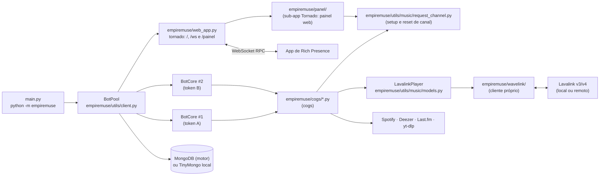

# Arquitetura do EmpireMuse

> EmpireMuse é obra derivada do [MuseHeart-MusicBot](https://github.com/zRitsu/MuseHeart-MusicBot),
> de **zRitsu** (licença GPL-2.0). Este documento descreve o código **como ele está hoje**; as referências
> `arquivo:linha` foram conferidas no código atual e podem deslocar-se com novos commits.

## 1. Visão geral

Um único processo Python (3.13) hospeda **vários bots do Discord** (um por token) e um **servidor web**
(tornado). Todo o áudio é processado por servidores **Lavalink** (v3/v4) ou NodeLink; o bot só controla os
players, a fila, a interface (embeds, botões, selects) e a persistência.

## 2. Processo e inicialização

1. `python -m empiremuse` instancia `BotPool()` e chama `pool.setup()` via `empiremuse/__main__.py:7-14`.
   Na raiz, `main.py` atua como atalho direto chamando `empiremuse.__main__.main()` (`main.py:1-4`).
2. A resolução de diretórios é centralizada em `empiremuse/paths.py`:
   - `PROJECT_DIR`: raiz do repositório, onde residem os diretórios de dados estáticos `data/` (servidores Lavalink) e `assets/` (imagens e marca).
   - `PACKAGE_DIR`: raiz do pacote `empiremuse/`, contendo código-fonte e templates compartilhados (`empiremuse/templates/status.html`).
   - `RUNTIME_DIR`: diretório para dados de execução (`local_database/`, `Lavalink.jar`, `application.yml`, `.logs/`, `lavalink.ini` etc.), determinado por `get_runtime_dir()` a partir da variável `EMPIREMUSE_HOME` (com fallback padrão para `Path.cwd().resolve()`).
3. `BotPool.__init__` (`empiremuse/utils/client.py:87`) carrega a configuração (`load_cfg` → `empiremuse.config_loader.load_config`),
   cria caches TTL, clientes Deezer/yt-dlp e restaura caches em pickle de `local_database/` sob `RUNTIME_DIR` (`empiremuse/utils/client.py:159-195`) com guardas defensivas contra dados corrompidos ou classes obsoletas.
4. `BotPool.setup` (`empiremuse/utils/client.py:597`) executa, em ordem:
   - carrega as skins (`load_skins`, `empiremuse/utils/client.py:516`);
   - monta a lista de nodes Lavalink: lista remota (`AUTO_DOWNLOAD_LAVALINK_SERVERLIST`), variáveis
     `LAVALINK_NODE_*` (JSON) e `lavalink.ini` em `RUNTIME_DIR` (`empiremuse/utils/client.py:611-665`);
   - decide se inicia o Lavalink local: `RUN_LOCAL_LAVALINK` ou nenhum node configurado (`empiremuse/utils/client.py:666`);
   - define as intents a partir das chaves `*_INTENT` (`empiremuse/utils/client.py:671-676`);
   - escolhe o banco: `MONGO` preenchido → `MongoDatabase`; caso contrário `LocalDatabase` (`empiremuse/utils/client.py:677-695`)
     — o `LocalDatabase` é sempre instanciado em `RUNTIME_DIR / "local_database"`;
   - cria `SpotifyClient` (se houver credenciais) e `LastFM` (`empiremuse/utils/client.py:726-740`);
   - varre **todas** as variáveis de ambiente/config atrás de strings com formato de token do Discord
     (`token_regex`, `empiremuse/utils/others.py:23`), de modo que qualquer chave pode conter um token (`empiremuse/utils/client.py:743-764`);
   - cria um `BotCore` por token via `load_bot` (`empiremuse/utils/client.py:766-950`) e, opcionalmente, bots exclusivos de
     servidor a partir de `guild_bots.json` em `RUNTIME_DIR` (`empiremuse/utils/client.py:965-976`);
   - sobe o servidor web com `web_app.start` (se `RUN_RPC_SERVER`) ou roda `run_bots` no loop (`empiremuse/utils/client.py:1009-1036`).
5. Cada `BotCore` (`empiremuse/utils/client.py:1039`, herda `commands.AutoShardedBot`) executa `initial_setup` depois do
   `on_ready`: carrega os cogs de `empiremuse.cogs`, sincroniza cooldowns e comandos de aplicação, registra `PanelView`
   (`empiremuse/utils/client.py:911-939`).
6. Ponto de extensão opcional: se existir o pacote `dev.pool_dev`, `PoolDev(self).run()` é executado
   (`empiremuse/utils/client.py:587-596`). Ele não existe no repositório.

### Estado compartilhado do pool

`BotPool` guarda o que é comum a todos os bots: `bots` e `guild_bots` (`empiremuse/utils/client.py:52-53`), a configuração,
os bancos (`database` escolhe Mongo ou local, `empiremuse/utils/client.py:218-224`), caches (`playlist_cache`,
`partial_track_cache`, `lyric_data_cache`), as skins e os clientes de integração. `BotCore` expõe esses
objetos por *properties* (`empiremuse/utils/client.py:1078-1108`).

## 3. Carregamento de módulos (cogs)

`BotCore.load_modules` (`empiremuse/utils/client.py:1449`) percorre recursivamente `empiremuse/cogs/` e `cogs_dev/` com `os.walk`,
e para cada `*.py` faz `unload_extension` + `load_extension` sob o prefixo `empiremuse.cogs` (recarrega se já estava carregado). Pontos
relevantes:

- `cogs_dev/` **não existe** no repositório; a pasta é lida se for criada (útil para módulos locais sem
  versionar). Como `os.walk` em pasta inexistente não gera itens, nenhum erro ocorre.
- Antes do bot ficar pronto, falha ao carregar um cog **interrompe** a inicialização (`raise e`,
  `empiremuse/utils/client.py:1488` e `1494`); depois, apenas registra a falha.
- Se `ENABLE_DISCORD_URLS_PLAYBACK` for falso, o comando `play_music_file` é removido (`empiremuse/utils/client.py:1498`).
- Descrições de slash commands acima de 100 caracteres derrubam o carregamento (`empiremuse/utils/client.py:1501-1504`).

## 4. Roteamento entre bots do pool

Com vários bots no mesmo servidor, **apenas um** deve responder a cada comando. A decisão fica em
`check_pool_bots` (`empiremuse/utils/music/checks.py:104`):

- Comando de barra: o check global (`empiremuse/utils/client.py:821-892`) lê as `extras` do comando (`only_voiced`,
  `check_player`, `return_first`, `allow_private`) e chama `check_pool_bots`.
- Comando com prefixo: `PoolCommand` (`empiremuse/utils/others.py:138`, decorador `pool_command`, `empiremuse/utils/others.py:250`) guarda as
  mesmas opções; `BotCore.on_message` chama `check_pool_bots` antes de `invoke` (`empiremuse/utils/client.py:1335-1350`).
- Algoritmo: com menos de 2 bots no servidor, o próprio bot atende (`empiremuse/utils/music/checks.py:121`); se um bot já está na
  call do autor, ele é o escolhido (`empiremuse/utils/music/checks.py:127-131`, `241-254`); senão escolhe o primeiro bot "livre"
  (sem player e com permissão de enviar mensagem) em ordem de `identifier` (laço em `empiremuse/utils/music/checks.py:208-286`,
  escolha em `295-309`).
- Para comandos com prefixo, todos os bots recebem a mensagem. A coordenação usa os eventos
  `pool_dispatch` e `pool_payload_ready` e `PoolException` para que os bots não escolhidos descartem o
  comando (`empiremuse/utils/music/checks.py:144-169`, `248-254`, `295-306`); `message_ids` (TTL 30 s) deduplica (`empiremuse/utils/client.py:106`).
- Erros de usuário (`NoVoice`, `NoPlayer`, `GenericError`) vêm de `empiremuse/utils/music/errors.py`.

## 5. Player

`LavalinkPlayer` (`empiremuse/utils/music/models.py:500`, herda `wavelink.Player`) concentra fila, loop, autoplay,
filtros, controlador (mensagem com botões), integração com skins e o RPC. O arquivo tem 4.018 linhas.
Outras classes: `LavalinkTrack` (`empiremuse/utils/music/models.py:335`), `PartialTrack` (`empiremuse/utils/music/models.py:101`, faixa de outra
plataforma resolvida só ao tocar) e `LavalinkPlaylist` (`empiremuse/utils/music/models.py:276`). `music_mode(bot)` apenas devolve
`wavelink.Client(bot=bot)` (`empiremuse/utils/music/models.py:4017`).

- **Faixas parciais** (Spotify/Deezer): o player busca equivalentes nas `partial_providers` do node
  (`ytsearch`, `scsearch`, `dzsearch`, …) e filtra por duração/título (`empiremuse/utils/music/models.py:2098-2135`).
- **Skins** são módulos com função `load()`: 10 em `empiremuse/utils/music/skins/normal_player/` e 5 em
  `static_player/` (15 no total), carregados dinamicamente por `load_skins` (`empiremuse/utils/client.py:516-559`). Skins
  personalizadas por servidor são guardadas no banco (ver seção 8).
- **UI**: views, botões e modais em `empiremuse/utils/music/interactions.py` (3.534 linhas). Os identificadores do
  controlador estão em `PlayerControls` (`empiremuse/utils/others.py:157`, prefixo `musicplayer_`).
- **Rich Presence**: `process_rpc` monta o payload e `_send_rpc_data` o envia por `ws_client`
  (`empiremuse/utils/music/models.py:3610-3740`).

## 6. Cliente Lavalink embutido (`empiremuse/wavelink/`)

Pacote local derivado do wavelink 0.9.x (`empiremuse/wavelink/__init__.py:5`, versão `0.9.15`; autor original EvieePy,
licença MIT — mantenha o cabeçalho). Foi estendido para o Lavalink **v4** e o NodeLink.

- **v3 × v4**: `Node.version` é detectado consultando `GET {rest_uri}/v4/info`: 200 → v4; 404 → v3
  (`empiremuse/wavelink/node.py:192-225`; também em `empiremuse/utils/client.py:336-386` e `empiremuse/cogs/music.py:7715-7785`). O WebSocket usa
  URL e cabeçalhos diferentes por versão (`empiremuse/wavelink/websocket.py:65-110`).
- **Resume**: v3 envia `Resume-Key` (`empiremuse/wavelink/websocket.py:73-74`); v4 envia `Session-Id` e `Session-Resumed`
  (`empiremuse/wavelink/websocket.py:76-82`). O `sessionId` vem do `op: ready` (`empiremuse/wavelink/websocket.py:178-184`). `Node.is_available` exige
  `session_id` na v4 (`empiremuse/wavelink/node.py:156-164`).
- **DAVE (Lavalink ≥ 4.2)**: o `channelId` é enviado na atualização de voz (`empiremuse/wavelink/player.py:318`).
- **Reconexão**: `wavelink_node_connection_closed` dispara `node_reconnect` com backoff
  (`empiremuse/cogs/music.py:7705-7785`), limitada por `LAVALINK_RECONNECT_RETRIES`.
- **Migração de players entre nodes**: ao perder o node, cada player aguarda outro via `_wait_for_new_node`
  (agendado em `empiremuse/cogs/music.py:7743`; definido em `empiremuse/utils/music/models.py:3527`); `Player.change_node`
  troca o node manualmente (`empiremuse/wavelink/player.py:613`) e o comando `change_node` expõe isso
  (`empiremuse/cogs/music.py:5265`).
- **Seleção de node**: `get_best_node`, `get_node_by_region`, `get_node_by_shard` (`empiremuse/wavelink/client.py:192`,
  `206`, `226`).
- **Conexão dos nodes**: `BotPool.node_check` verifica cada node e agenda `connect_node` em todos os bots
  (`empiremuse/utils/client.py:336-433`); `Music.connect_node` cria o `Node` e monta `search_providers`/`partial_providers`
  (`empiremuse/cogs/music.py:7880-7940`).

### Lavalink local

`empiremuse/utils/music/local_lavalink.py` valida Java ≥ 17 (`empiremuse/utils/music/local_lavalink.py:115`), baixa JDK/`Lavalink.jar`/`application.yml`/plugins se
necessário (o jar, o yml e os plugins vêm do espelho `DiscordEmpireHub/EmpireMuse-LL-binaries` `0.0.3`, veja `empiremuse/utils/branding.py`, com validação de integridade por SHA-256; a 0.0.3 traz o cliente TV no `application.yml`, OAuth desligado por padrão e log do `YoutubeOauth2Handler` em WARN; pacotes do JDK baixados sob demanda têm SHA-256 fixo em `branding.JDK_DOWNLOADS` com extração atômica e segura no Linux).

O processo é iniciado com `subprocess.Popen` em executor para não bloquear o loop (`empiremuse/utils/client.py:234-248`), repassando explicitamente `cwd=RUNTIME_DIR` (resolvido centralmente por `empiremuse.paths`), garantindo que os binários, arquivos de configuração e diretório `plugins/` fiquem isolados sob o diretório de dados em execução. Em vez de herdar o ambiente completo do bot (`os.environ`), o Lavalink local recebe um ambiente estritamente isolado via `lavalink_child_env` (`empiremuse/utils/music/local_lavalink.py`), repassando somente variáveis essenciais do sistema (*allowlist*: `PATH`, `HOME`, `LANG`, `LC_ALL`, `LC_CTYPE`, `TZ`, `TMPDIR`, `TEMP`, `TMP`, `JAVA_HOME`, `SERVER_PORT` e variáveis essenciais no Windows). As variáveis `PLUGINS_YOUTUBE_OAUTH_*` só são inseridas se houver um `YOUTUBE_OAUTH_REFRESH_TOKEN` não vazio. Tokens do bot, bancos de dados e opções de JVM do ambiente (`JAVA_TOOL_OPTIONS`/`_JAVA_OPTIONS`) não chegam ao subprocesso. O node local usa identificador `LOCAL`, host `127.0.0.1` e porta `SERVER_PORT` ou `8090` (`empiremuse/utils/client.py:416-430`).

No modo contêiner (ou em ambientes com Lavalink pré-instalado), o bot opera em modo estritamente offline configurável via `LAVALINK_OFFLINE=true`, apontando para o runtime Java em `LAVALINK_JAVA_PATH` e os binários em `LAVALINK_HOME`, dispensando downloads de JDK e validando os artefatos existentes exclusivamente por SHA-256 antes da execução. A inicialização força a vinculação em `127.0.0.1` (`SERVER_ADDRESS=127.0.0.1`) e suprime requisições externas ao repositório Maven na partida gerando dinamicamente um arquivo de override em runtime. O ciclo de vida do processo Java é supervisionado continuamente pela função vigia `watch_lavalink_process` em thread daemon; caso o processo termine inesperadamente, o encerramento ordenado do bot é acionado com código de erro, delegando a recuperação ao supervisor de contêineres (Docker). Já reinicializações controladas ou comandos de suporte utilizam `BotPool.stop_lavalink`, que finaliza a instância de áudio de forma esperada sem derrubar o bot.

## 7. Servidor web, RPC e Painel Web (`empiremuse/web_app.py` e `empiremuse/panel/`)

Aplicação Tornado (`empiremuse/web_app.py`) executando sob `HTTPServer` com limite global de corpo de requisições de 64 KiB (`max_body_size = 65536`) e escutando no endereço configurado por `WEB_BIND_ADDRESS` (padrão `0.0.0.0`; se exposto em `0.0.0.0` com `ENABLE_RPC_AUTH=false`, um aviso é registrado no log) e porta `PORT` ou `SERVER_PORT` (padrão 80 ou 8080 via `resolve_port`).

A função `make_router` organiza o roteamento das requisições:
- `/` e `/ws` são atendidos pela aplicação principal do status e RPC;
- `/painel` e `/painel/*` são direcionados para a sub-aplicação `empiremuse/panel/` quando `PANEL_ENABLED=true` (com `panel_app=None`, requisições caem no fallback 404 da aplicação principal).

| Rota | Handler / Componente | Função |
|---|---|---|
| `/` | `IndexHandler` | Página de status: bots prontos (com link de convite), pendentes, falhas de token, link do app de RPC, prefixo e commit (`empiremuse/web_app.py`). |
| `/ws` | `WebSocketHandler` | Relé de mensagens do RPC entre os bots e o app desktop (`empiremuse/web_app.py`). |
| `/painel` | `build_panel_app` (`empiremuse/panel/`) | Sub-aplicação web de gerenciamento do bot com login via Discord, controle de sessões e interface orientada a hipertexto. |

### Relé WebSocket do RPC e Protocolo (`empiremuse/rpc_protocol.py`)

Os bots internos e o aplicativo desktop de Rich Presence comunicam-se via `/ws`. Os próprios bots conectam-se ao `/ws` (ou a um `RPC_SERVER` externo) através de `WSClient` (`empiremuse/web_app.py`), com reconexão automática por backoff.

As definições do protocolo, limites, constantes e validações puras (sem I/O) ficam encapsuladas no módulo `empiremuse/rpc_protocol.py`:

- **Registro e autenticação de bots**: conexões de bots autenticam-se obrigatoriamente através do cabeçalho `X-RPC-Key` (`RPC_KEY_HEADER`). O segredo esperado é definido por `RPC_SERVER_SECRET`; se vazio, o servidor e os bots do mesmo processo compartilham um segredo efêmero gerado automaticamente a cada inicialização (`get_rpc_secret`). Apenas conexões com cabeçalho validado em tempo constante (`hmac.compare_digest`) e registradas explicitamente com `"bot": true` são adicionadas a `bots_ws` e autorizadas a enviar dados aos usuários.
- **Autenticação de usuários**: a exigência de autenticação é governada exclusivamente pela opção `ENABLE_RPC_AUTH` no servidor (`server_auth`). Quando ativada, a entrega de dados ao usuário exige token não vazio e idêntico em ambas as pontas (`authenticates` com comparação em tempo constante). Token divergente, ausente, vazio ou nulo bloqueia a sessão e encaminha evento `exception` orientando o usuário a gerar novo token com `/rich_presence`. Com `ENABLE_RPC_AUTH=false`, a entrega ocorre diretamente sem validação de token.
- **Origem de conexões de navegador**: clientes nativos (app desktop e bots) não enviam cabeçalho `Origin`. Conexões de navegador passam por `check_origin` e só são aceitas se provierem da mesma origem do servidor ou de domínios explicitamente autorizados na lista `RPC_ALLOWED_ORIGINS`.
- **Limites e controle de capacidade**:
  - Limite de mensagem: máximo de 64 KiB (`MAX_MESSAGE_SIZE` e `websocket_max_message_size`).
  - Limite de conexões: até 1000 conexões simultâneas (`MAX_CONNECTIONS`). Ao atingir a capacidade, novas conexões são recusadas com código `1013` (`CLOSE_TRY_AGAIN_LATER`).
  - Limite de taxa: clientes passam por limitador de taxa em janela deslizante (`RateLimiter`, padrão de 20 mensagens em 10 segundos). O excesso encerra a conexão com código `4429` (`CLOSE_RATE_LIMITED`).
  - Limites de identificadores: no máximo 3 IDs por conexão de usuário (`MAX_USER_IDS`) e até 250 IDs por conexão de bot (`MAX_BOT_IDS`).
- **Saneamento e filtragem de campos**: dados repassados entre pontas são filtrados estritamente por `pick_fields`: dados de usuário para bot limitam-se a `USER_TO_BOT_FIELDS` (`op`, `user_ids`, `version`), e dados de bot para usuário a `BOT_TO_USER_FIELDS` (sem repassar `token` ou `auth_enabled`).
- **Códigos de fechamento WebSocket**:
  - `4400` (`CLOSE_MALFORMED`): JSON malformado, tipo inválido, registro duplicado ou IDs fora dos limites.
  - `4401` (`CLOSE_UNAUTHORIZED`): tentativa de registro de bot sem chave válida ou mensagem de bot originada de conexão cliente não autorizada.
  - `4429` (`CLOSE_RATE_LIMITED`): taxa de envio excedida por clientes.
  - `1013` (`CLOSE_TRY_AGAIN_LATER`): capacidade máxima do servidor atingida.
  - `4200` (`CLOSE_REFUSED`): encerramento de sessão anterior substituída por nova conexão do mesmo usuário ou desconexão por falta de IDs.

O payload de status `update`/`idle` é montado em `LavalinkPlayer.process_rpc` (`empiremuse/utils/music/models.py`). Se `RUN_RPC_SERVER` for falso e `RPC_SERVER` apontar para o próprio host, `connect_rpc_ws` em `empiremuse/utils/client.py` não conecta.

### Sub-aplicação do Painel Web (`empiremuse/panel/`)

O painel web é ativado quando `PANEL_ENABLED=true` e requer `RUN_RPC_SERVER=true` para que o servidor web suba. Ele foi desenhado sob o princípio de dependência zero adicional e segurança rigorosa:

- **Autenticação OAuth2 (`empiremuse/panel/oauth.py`)**: implementa o fluxo *Authorization Code Grant* com geração criptográfica de `state` e par PKCE S256 (`code_verifier` e `code_challenge`), associados a uma tentativa de login de uso único (10 minutos de validade). Ao obter o token temporário do Discord, lê os perfis e servidores (`identify` e `guilds`) e executa **revogação mandatória e imediata** do token via `POST /oauth2/token/revoke`. Nenhum token de acesso é persistido.
- **Sessões e Cookies (`empiremuse/panel/sessions.py`)**: as sessões ativas residem em memória, associadas a um ID aleatório de 32 bytes emitido em cookie assinado (`cookie_secret`). Em produção com HTTPS, utiliza o prefixo de segurança `__Host-` (`__Host-painel_sessao`) com flags `Secure`, `HttpOnly`, `SameSite=Lax` e `Path=/`. Para desenvolvimento local em `http://localhost`, a flag `PANEL_INSECURE_COOKIES=true` autoriza cookies normais sem a flag `Secure`.
- **Autorização Autoritativa (`empiremuse/panel/authz.py`)**: a lista de servidores do OAuth funciona apenas como pré-filtro. Toda ação em `/painel/servidores/<gid>` valida no servidor com dados do `BotPool`: verifica se algum bot do pool está presente na guilda e se o usuário logado é dono do servidor ou possui as permissões `administrator` ou `manage_guild`. Leituras utilizam cache de até 30 segundos; escritas usam verificação mandatória em tempo real (`fresh=True`).
- **Serviços Puros e Concorrência Otimista (`empiremuse/panel/services/`)**: as regras de configuração de servidores (Player, DJ, Aparência, Links fixos, Geral) e conta (prefixo pessoal, favoritos, integrações, Last.fm e token RPC) são implementadas em serviços desacoplados do HTTP, espelhando com paridade as regras dos comandos do bot. Cada formulário inclui um campo oculto `versao` baseado no hash SHA-256 dos campos pertinentes sob bloqueio assíncrono (`asyncio.Lock`), prevenindo sobrescrita de dados concorrente (retorno HTTP 409).
- **Canal de Pedidos e Tarefas Assíncronas (`empiremuse/panel/services/channel.py`, `channel_tokens.py`, `tasks.py` e `empiremuse/utils/music/request_channel.py`)**: a lógica de `/setup` e `/reset` foi centralizada em `empiremuse/utils/music/request_channel.py`, compartilhada entre os cogs de comandos e o painel. O painel executa configurações demoradas via `TaskRunner` assíncrono em background, com atualização de estado por polling htmx e encerramento gracioso via `_shutdown_panel()` no desligamento do servidor.
- **Frontend e Segurança de Conteúdo**: interface construída com templates nativos do Tornado, trocas parciais de HTML via **htmx 2.0.10** (0BSD) e folhas de estilo **Pico CSS 2.1.1** (MIT) vendorizadas em `empiremuse/panel/static/vendor/` (com hashes validados em `SHA256SUMS`) e estendidas por `empiremuse/panel/static/css/nebulosa.css`. Política de Segurança de Conteúdo (CSP) rígida sem `'unsafe-inline'` nem `'unsafe-eval'`. Proteção XSRF obrigatória em todas as requisições `POST`.

## 8. Persistência

**Backends** (`empiremuse/utils/db.py`): `MongoDatabase` (motor, `empiremuse/utils/db.py:223`) ou `LocalDatabase` (TinyMongo em
`RUNTIME_DIR / "local_database"`, `empiremuse/utils/db.py:156`), ambos com cache TTL (`DBCACHE_SIZE`/`DBCACHE_TTL`). O acesso passa por
`BotCore.get_data/update_data` (coleção = id do bot) e `get_global_data/update_global_data` (coleção
`global`) — `empiremuse/utils/client.py:1110-1132`.

**Modelos e versionamento** (`empiremuse/utils/db.py:31-90`): cada documento tem `ver`; se a versão difere do modelo,
`update_values` mescla o padrão com os dados salvos (`empiremuse/utils/db.py:184-188`, `290-293`, `321-327`).

| Banco/coleção | Modelo | Conteúdo |
|---|---|---|
| `<id do bot>` / `guilds` | `db_models[guilds]` v1.11 | Canal/mensagem do controlador, skin, `autoplay`, volume padrão, DJ roles, modo restrito. |
| `<id do bot>` / `users` | `db_models[users]` v1.0 | Favoritos do usuário. |
| `global` / `users` | `global_db_models[users]` v1.6 | Favoritos, integrações, `token` do RPC, prefixo próprio, últimas faixas, dados do Last.fm. |
| `global` / `guilds` | `global_db_models[guilds]` v1.4 | Prefixo, skins globais, **skins personalizadas**, status do canal de voz, convites "ouvir junto". |
| `global` / `default` | `global_db_models[default]` v1.0 | Tokens extras. |
| `global` / `global` (id `youtube_data`) | sem modelo | `refresh_tokens` do OAuth do YouTube (`empiremuse/utils/client.py:391`). |
| `player_sessions` / `<id do bot>` | sem modelo | Sessões de players para retomada (`empiremuse/cogs/player_resume.py:759-765`). |

**Serialização binária legada e guardas de cache:** sessões de player, skins personalizadas e filas salvas utilizam tipos primitivos padrão e dicionários serializados em binário, sem referenciar classes internas dos módulos do bot (`b"empiremuse"`, `b"utils."` ou `b"modules."`). Em `BotPool.load_cache`, o carregamento de caches em pickle (`playlist_cache.pkl`, `partial_track_cache.pkl`, `.lyric_cache_data`) possui guardas defensivas com tratamento de `(ModuleNotFoundError, AttributeError, pickle.UnpicklingError, EOFError)`, descartando automaticamente caches incompatíveis ou corrompidos com aviso defensivo no logger (`logger.warning`), garantindo que o bot inicialize com segurança sem interrupções.

Outros arquivos locais: `.app_commands_sync_data/<id>.json` (hash dos comandos já sincronizados,
`empiremuse/utils/client.py:1141-1176`), `guild_bots.json`, `auto_lavalink.ini` em `RUNTIME_DIR` e o cache de token do Spotify em
`RUNTIME_DIR / ".spotify_cache.json"` (respeitando `EMPIREMUSE_HOME`, com permissão restrita `0600` e gravação atômica; `spotify_cache_path()` em `empiremuse/utils/music/audio_sources/spotify.py`).

## 9. Integrações externas

| Integração | Onde | Observações |
|---|---|---|
| **Lavalink** (v3/v4, NodeLink) | `empiremuse/wavelink/`, `empiremuse/cogs/music.py` | Fonte de áudio única; lista pública opcional (`empiremuse/utils/music/remote_lavalink_serverlist.py`, padrão `data/lavalink_servers.ini`). `Lavalink.jar`, `application.yml` e plugins vêm do espelho [DiscordEmpireHub/EmpireMuse-LL-binaries](https://github.com/DiscordEmpireHub/EmpireMuse-LL-binaries) `0.0.3` (Lavalink oficial 4.2.2; `application.yml` com cliente TV, OAuth opcional desligado por padrão e log do `YoutubeOauth2Handler` em WARN). |
| **App de RPC (Rich Presence)** | `empiremuse/web_app.py`, `empiremuse/utils/music/models.py` | Aplicativo desktop [DiscordEmpireHub/EmpireMuse-RPC-app](https://github.com/DiscordEmpireHub/EmpireMuse-RPC-app) (origem: upstream, GPL-3.0); URLs em `empiremuse/utils/branding.py`. |
| **Spotify** | `empiremuse/utils/music/audio_sources/spotify.py` | API oficial por *client credentials* (`SPOTIFY_CLIENT_ID/SECRET`); só metadados, o áudio vem de outra fonte. Veja `known-issues.md`. |
| **Deezer** | `empiremuse/utils/music/audio_sources/deezer.py` | API pública sem credenciais; metadados. |
| **Last.fm** | `empiremuse/utils/music/lastfm_tools.py`, `empiremuse/cogs/lastfm.py` | Scrobble e perfil; exige `LASTFM_KEY/SECRET`. |
| **YouTube / SoundCloud (yt-dlp)** | `CustomYTDL` (`empiremuse/utils/music/models.py:4012`), `empiremuse/utils/client.py:124-152`, `empiremuse/utils/music/ytdl_tools.py` | `allowed_extractors` restrito a YouTube/SoundCloud no pool; extração sem download. |
| **YouTube OAuth / PoToken** | `empiremuse/cogs/ll_yt_oauth.py`, `empiremuse/wavelink/node.py:261`, `empiremuse/utils/music/youtube_trusted_session_generator.py` | Autenticação do plugin `youtube-plugin` do Lavalink e geração de `poToken` (`nodriver`). |
| **Discord** | `disnake` (commit git fixado, `requirements.txt:1`) | Slash/prefix/menus de contexto; `AutoShardedBot`. |

## 10. Módulos → responsabilidade → tamanho

Linhas medidas com `wc -l` (total do projeto: ~34,5 mil linhas Python; testes em `tests/`, veja `development.md`).

| Módulo | Responsabilidade | Linhas |
|---|---|---|
| `main.py` | Atalho de inicialização na raiz (chama `empiremuse.__main__`) | 4 |
| `empiremuse/__main__.py` | Ponto de entrada canônico do pacote (`python -m empiremuse`) | 14 |
| `empiremuse/paths.py` | Resolução central de diretórios (`PROJECT_DIR`, `PACKAGE_DIR`, `RUNTIME_DIR`) | 22 |
| `empiremuse/config_loader.py` | Padrões, leitura de env/`config.json`/`.env`, conversão de tipos | 333 |
| `empiremuse/rpc_protocol.py` | Protocolo do relé RPC: validações, limites, sanitização e rate limit | 156 |
| `empiremuse/web_app.py` | Status HTTP, relé WebSocket do RPC, roteador do painel web | 651 |
| `empiremuse/panel/` | Sub-aplicação web Tornado: OAuth2, sessões, handlers, serviços puros, templates e estáticos | 4.306 |
| `empiremuse/utils/music/request_channel.py` | Lógica unificada de setup e reset de canal de pedidos compartilhada entre cogs e painel | 497 |
| `empiremuse/utils/client.py` | `BotPool` (setup, nodes, tokens) e `BotCore` (prefixo, sync, módulos) | 1.511 |
| `empiremuse/utils/db.py` | Modelos, `MongoDatabase`, `LocalDatabase`, prefixos | 330 |
| `empiremuse/utils/others.py` | Contexto, `PoolCommand`, paginação, emojis, utilitários | 893 |
| `empiremuse/utils/owner_panel.py` | Painel do dono (`PanelView`) | 75 |
| `empiremuse/utils/music/models.py` | `LavalinkPlayer`, faixas, playlists, yt-dlp | 4.018 |
| `empiremuse/utils/music/interactions.py` | Views/modais: fila, favoritos, skins, controles | 3.534 |
| `empiremuse/utils/music/checks.py` | Roteamento do pool, checks de DJ/voz/permissão | 813 |
| `empiremuse/utils/music/local_lavalink.py` | Download/execução do Lavalink e do JDK locais | 497 |
| `empiremuse/utils/music/audio_sources/` | Clientes Spotify (488) e Deezer (300) | 788 |
| `empiremuse/utils/music/skins/` | 15 skins (10 normal + 5 estática) | 3.032 (soma) |
| `empiremuse/utils/music/{converters,errors,filters,skin_utils,track_encoder,…}.py` | Auxiliares de música | 1.506 |
| `empiremuse/wavelink/` | Cliente Lavalink v3/v4 (node, websocket, player, eventos) | 2.850 |
| `empiremuse/cogs/music.py` | Comandos de música (play, fila, controles, nodes) | 8.688 |
| `empiremuse/cogs/music_settings.py` | Configurações por servidor/usuário, skins, favoritos | 1.831 |
| `empiremuse/cogs/player_resume.py` | Salvar e retomar sessões de players | 854 |
| `empiremuse/cogs/misc.py` | Comandos gerais (ping, convite, sobre, …) | 1.042 |
| `empiremuse/cogs/legacy_cmds.py` | Comandos legados/administrativos (prefixo) | 1.177 |
| `empiremuse/cogs/lastfm.py` | Integração Last.fm | 739 |
| `empiremuse/cogs/error_handler.py` | Tratamento global de erros e relatório | 511 |
| `empiremuse/cogs/help_cog.py` | Comando de ajuda | 406 |
| `empiremuse/cogs/ll_yt_oauth.py` | OAuth do YouTube para o Lavalink | 290 |
| `empiremuse/cogs/server_manager.py` | Gestão de servidores/bots do dono | 209 |
| `empiremuse/utils/branding.py` | Fonte única de identidade e URLs (nome, repositório, espelhos, upstream, `asset_url`); só stdlib, sem efeitos colaterais no import | — |
| `assets/` | Imagens re-hospedadas (previews, skins, ícones, tutoriais) + `SHA256SUMS`; servidas via `ASSETS_BASE_URL` | — |
| `data/lavalink_servers.ini` | Lista de servidores Lavalink públicos (origem: gist do upstream, com crédito no cabeçalho) | — |
| `docs/guides/` | Guias técnicos oficiais do projeto (Lavalink local, YouTube OAuth, painel web, Spotify e Docker) | — |
| `docs/painel/` | Pesquisas técnicas e inventários de requisitos do painel web | — |
| `tests/` | Testes automatizados (pytest e pytest-cov); testes de marca, regras e painel web | — |

## 11. Implantação

Os tutoriais genéricos de hospedagem de terceiros (Heroku, Repl.it e guias legados de MongoDB) foram completamente expurgados da documentação no Bloco C3 em favor do escopo oficial do bot para a comunidade EmpireHub.

Quanto à infraestrutura e artefatos de deploy, os scripts legados (`source_*.sh/.bat`), configurações desatualizadas de hospedagens (`.Dockerfile`, `render.yaml`, `discloud.config.example`, `squarecloud.config.example`, `.replit`, `replit.nix`, `.gitpod.yml`, `deploy_handlers/`) e atalhos redundantes (`app.py`) foram inteiramente expurgados na Fase D (Bloco D1). A execução oficial do projeto é consolidada em torno do pacote canônico `empiremuse` via Python 3.13 (`python -m empiremuse` ou `python main.py`), contêineres Docker oficiais e Docker Compose (modernizados no Bloco D2).
